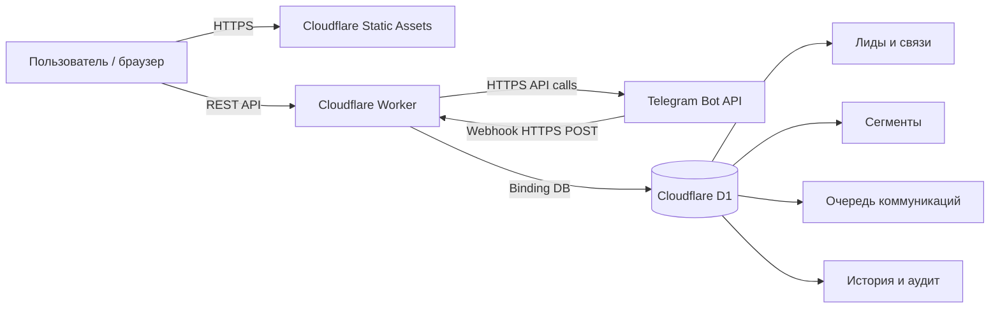
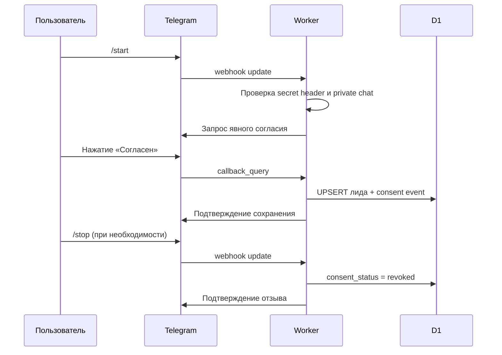
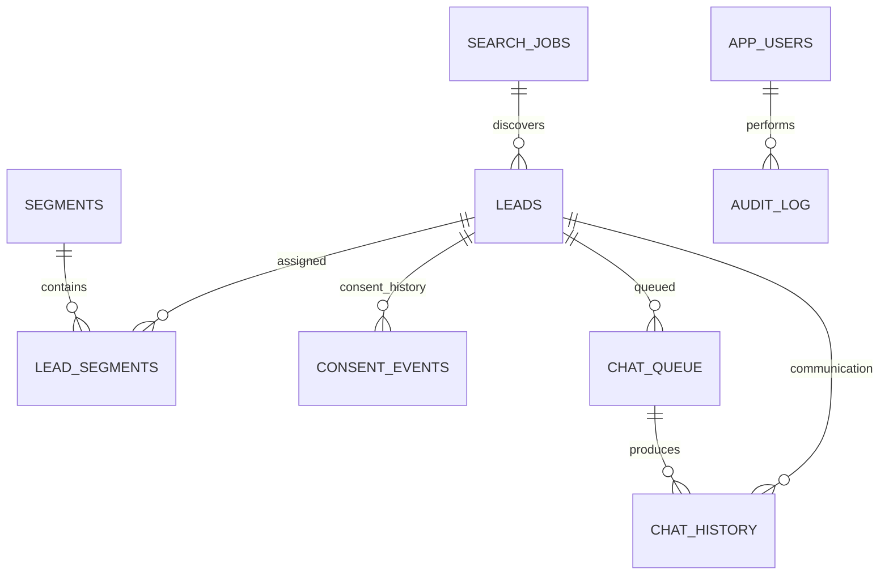

# Архитектура Lead Database Manager

**Версия документа:** 0.2.0 · **Дата проверки:** 12.11.2026

## 1. Целевая схема

## 2. Зоны ответственности

| Слой | Компонент | Ответственность |
|---|---|---|
| UI | Static Assets | Отображение таблиц, форм, фильтров и состояний; никакого доступа к секретам |
| API | Cloudflare Worker | Авторизация, валидация, бизнес-правила, маршрутизация, лимиты |
| Storage adapter | D1 repository layer | SQL-запросы, транзакционные пакеты, пагинация; бизнес-логика не должна зависеть от SQL напрямую |
| Database | Cloudflare D1 | Централизованные записи, сегменты, очереди, история, индексы |
| Integration | Telegram adapter | Webhook, проверка подписи-секрета, получение разрешённых обновлений и ответы бота |
| Export | Worker + R2 (опционально) | Серверное формирование файлов; R2 добавляется только при реальной необходимости |

## 3. Принятые проектные решения

1. **Один D1 для одного окружения** на первой версии; разделы — логические сущности, а не отдельные физические базы.
2. **REST API** — единственный путь доступа frontend к хранилищу.
3. **Параметризованные SQL-запросы** — обязательны; динамические значения нельзя конкатенировать в SQL.
4. **Идентификатор Telegram хранится текстом** — исключает ненужные преобразования и потери точности при будущих изменениях API/языка.
5. **Сегменты через `lead_segments`** — many-to-many, один лид может состоять в нескольких разделах.
6. **Согласие — отдельное состояние** (`none`, `granted`, `revoked`), не смешивается со статусом обработки лида.
7. **Очередь коммуникаций строится только из лидов с действующим согласием**. Серверная проверка обязательна при создании задачи и непосредственно перед отправкой.
8. **Идемпотентность** — уникальный `telegram_updates.update_id` для входящих webhook, `consent_events.event_key` для событий согласия и `chat_queue.idempotency_key` для будущих действий.
9. **Миграции только вперёд** — уже применённые numbered SQL-файлы не редактировать.
10. **D1 adapter** — слой репозиториев/интерфейс `LeadRepository`; в дальнейшем PostgreSQL-реализация может реализовать тот же контракт.

## 4. Потоки данных

### 4.1. Разрешённое добавление лида через бота

### 4.2. Ручное управление

UI → Worker REST endpoint → валидатор → service/use-case → repository adapter → D1. Ответ API содержит `ok`, `error`, `item` / `items`, `pagination` и прикладные метаданные.

## 5. Предполагаемое разбиение Worker на модули

- `routes/` — маршруты API.
- `services/` — бизнес-операции (lead, segment, search, export, queue).
- `repositories/` — изоляция SQL/D1.
- `integrations/telegram/` — webhook и Telegram Bot/Client API.
- `middleware/` — авторизация, валидация, rate limiting, журнал.
- `shared/` — типы, ответы, константы, ошибки.

В Stage 1 код оставлен компактнее: сложное разделение будет реализовано по мере появления реальных модулей, без искусственного создания пустых файлов.

## 6. Ограничения архитектуры

- D1 — SQLite-совместимая serverless БД, а не PostgreSQL; запросы и типы должны оставаться переносимыми.
- Одна D1 база обрабатывает запросы последовательно; `batch()` уменьшает overhead, массовые изменения нужно порционировать.
- В бесплатном тарифе Worker имеет дневную квоту запросов и низкий CPU budget. Дорогой экспорт и фоновые задачи требуют отдельного дизайна.
- Exactly-once для внешнего Telegram side-effect и записи в D1 не гарантируется одной транзакцией: между вызовом Telegram и отметкой состояния возможен обрыв. Для очереди следующего этапа потребуется outbox/claim/lease и ручная политика повторов.

## 7. ER-связи

Справочная полная модель: `../migrations/FUTURE_SCHEMA.sql`. В v0.2.0 созданы основные рабочие таблицы лидов, разделов, связей, аудита, поиска и очередей. Таблицы очереди и поиска пока являются схемой для следующих этапов.
